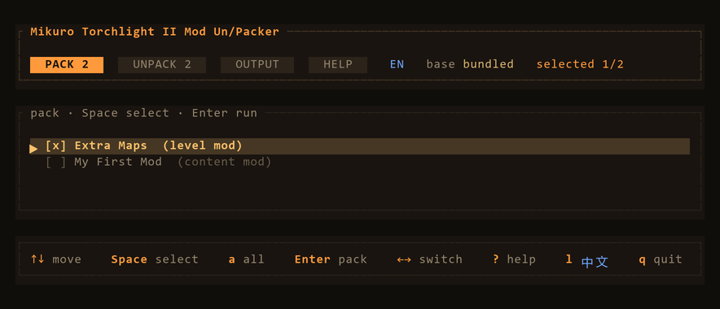

# tl2-mikuro-mod-packer-rs

*[中文](README.zh-CN.md) · [Русский](README.ru.md)*

A **`.MOD` packer and unpacker** for Torchlight 2: a single executable, with no
need for the game's editor (GUTS).

- **Pack**: compile a mod source folder (`MOD.DAT` + `MEDIA/`) into a `.MOD` the game reads.
- **Unpack**: turn a `.MOD` (or the base game's `DATA.PAK`) back into an **editable text source tree**.

All three binary formats (BINDAT / BINLAYOUT / MPP) are compilers written from
scratch: parse text → serialise binary, never reading an existing binary, so an
edit to the text always compiles correctly. The two decompilers are the same in
reverse. Building a **content** mod needs nothing but the mod itself; a **level**
mod also needs the base game's data, and the exe asks you where that is rather
than guessing (see [Base data](#base-data-why-packing-needs-it)).

The Python reference implementation `mikuro_mod_packer` is archived at GitHub
`heiybb/TL2-RE`; this repository is the only implementation in use.

> **Want the whole story?** How the container is assembled, what each of the five
> binary formats actually is, which single hash the game validates, how the pathing
> grid is baked, plus the real mechanism behind the classic failures (ticked in the
> launcher but nothing happens / a portrait turned into some other image / players
> can't move after a level transition):
> **[What's Actually Inside a .MOD](https://tl2-mod.chr.moe/en/devlog/tl2-mod-packing-full-analysis/)**
> on Emberworks. This README is the manual; that post is the explanation.

---

## Speed against the game's own editor

Building the whole 挑战者大陆 series (ten components, 173k files) takes the official
GUTS editor **983 seconds**; this packer takes **46**. Per component the speedup runs
from 2× to 43×, and the widest gaps are exactly where the editor bakes pathing grids.

The native numbers come from the benchmark in the archived `heiybb/TL2-RE`
(a forked headless `tl2_console_fork` driving the real EditorGuts.dll; InitEditor's
one-off 3.85s is amortised, warm timing over `CreateMod` + `EditorRegenPathingData`).
These 5 Rust runs used the **same source copies as the native benchmark**
(`E:\Torchlight 2\mods`, which carries compiled siblings, hence the higher file counts).

| Component | Files | native build | native MPP | native total | Rust ×5 (s) | Rust mean | Speedup |
| --- | --: | --: | --: | --: | --- | --: | --: |
| 通用素材01 | 12712 | 164.05 | 208.77 | 372.82 | 6.46/11.75/12.37/6.25/6.05 | **8.58** | **43.5×** |
| 职业技能 | 68217 | 268.42 | 0.00 | 268.42 | 12.14/19.55/8.85/9.30/11.05 | **12.18** | **22.0×** |
| 群魔堕落 | 52438 | 169.36 | 0.51 | 169.87 | 12.79/7.56/7.66/8.09/16.58 | **10.54** | **16.1×** |
| 暗黑传奇 | 32020 | 97.86 | 6.02 | 103.88 | 9.46/5.21/5.36/9.76/10.18 | **7.99** | **13.0×** |
| 暗黑世界(临时) | 354 | 9.68 | 17.26 | 26.94 | 0.89/0.76/2.10/2.30/1.73 | **1.56** | **17.3×** |
| 佣兵系统 | 2956 | 14.16 | 0.86 | 15.02 | 1.09/0.79/1.02/2.48/2.47 | **1.57** | **9.6×** |
| 至尊适配 | 1818 | 11.14 | 0.00 | 11.14 | 0.82/0.56/0.57/1.23/1.31 | **0.90** | **12.4×** |
| 实验内容 | 470 | 8.31 | 0.00 | 8.31 | 0.65/0.47/0.47/1.07/1.06 | **0.74** | **11.2×** |
| 护身符 | 1348 | 4.29 | 0.00 | 4.29 | 0.48/0.36/0.96/0.99/0.33 | **0.62** | **6.9×** |
| 宠物系统 | 431 | 1.96 | 0.17 | 2.13 | 0.51/0.43/1.83/1.76/0.38 | **0.98** | **2.2×** |
| **Total** | | 749.2 | 233.6 | **982.8** | | **45.66** | **21.5×** |

- Summing each component's best of 5 gives 31.0s → **31.7×**; the run-to-run spread is
  mostly Defender's real-time scanning and write-back cache flushes (each round writes
  ~600 MB of `.MOD`).
- 地图拓展 (242.98s) and POE (52.72s) appear in the native table but their source
  copies were deleted and cannot be re-measured, so they are excluded from the total.
- MPP is not like-for-like: native = EditorRegenPathingData (byte-exact); Rust = the
  offline `re` backend (≈99.7% cell-accurate, a known ceiling; actual walkability is
  at the float floor; see [Are the baked walk-grids safe to ship?](#walkgrid)).

---

## Quick start

```powershell
cargo build --release
# produces target\release\tl2-mikuro-mod-packer.exe — one file, copy it anywhere
```

Three ways to drive it, depending on what you want:

| You want | Do this |
| --- | --- |
| Click through it | **Double-click the exe** (or drop it in a mod folder / the game folder and run it) → interactive UI |
| Scripting, CI | Run it with arguments → an ordinary command-line tool |
| One file at a time | The `compile-dat` / `decompile-layout` / … subcommands |

---

## A walk through the interface

Started with no arguments, it opens on the picker. The images below are the real
frames the program draws, in English; the [Chinese](README.zh-CN.md) and
[Russian](README.ru.md) READMEs show the same walkthrough in their own language.
Notice what is *not* translated: mod names, paths, and every CLI flag, because
those are what you type.

### 1 · Choose what to pack



Every folder holding `MOD.DAT` shows up here: from the exe's own folder, its
`mods\` subfolder, and the folder itself if that is where you dropped the exe.
`↑↓` moves, `Space` ticks, `a` ticks everything, `Enter` starts. With nothing
ticked, `Enter` packs the row under the cursor.

Both lists are scanned when the program starts. `r` scans again, so a mod folder
you just added, or a `.MOD` you just built or deleted, shows up without a
restart. Your ticks and the cursor stay where they were.

Each row is tagged `level mod` or `content mod`. One test decides it: does
`MEDIA/LAYOUTS` hold any `*.LAYOUT`? That decides whether the pathing
walk-grids get baked, which is the slow part of a build.

### 2 · Watch it run


The view switches to OUTPUT and streams the packer's own log line by line, so a
long build never looks like it hung. `↑↓` scrolls (which stops the auto-follow),
`End` re-follows the tail, `c` clears the transcript, `q` quits, but not while a
run is going, so a child process is never orphaned.

### 3 · Unpack, the other direction


`.MOD` files found next to the exe, in `.\mods`, and (the one that matters) in
the game's own mods folder, each row tagged `local` or `game mods` so you can tell
your fresh build from what is installed. Output lands in `unpacked\<name>\` next
to the exe. **The game's mods folder is never written to by an unpack**, so taking
apart something you have installed is safe.

---

## Packing

### What counts as a mod source

A folder holding **`MOD.DAT`** and a **`MEDIA/`** tree. `MOD_FILE_NAME` in
`MOD.DAT` decides the output file name (the folder name is the fallback);
`NAME` / `DISPLAYNAME` decide the title the game shows.

### The command

```powershell
tl2-mikuro-mod-packer.exe [--in-place|--temp-copy] [--mpp {re,none}] [--raw {auto,none}] [--deploy] <mod_dir>
```

Four things happen, in order (`convert_all`):

1. `*.DAT` → BINDAT
2. `*.LAYOUT` → BINLAYOUT
3. `MEDIA/*.RAW` indexes are generated (AFFIXES / SKILLS / TRIGGERABLES / MISSILES / UI / UNITDATA / ROOMPIECES)
4. `.MPP` pathing walk-grids are baked (level mods only)

Then the container is written: header + data section + manifest, plus the two
hashes the game validates (rollingHash, manifest mhash).

### Where the compiled files land: pick one

This is the only question `--in-place` / `--temp-copy` answer:

| Flag | Behaviour |
| --- | --- |
| none (default) | Compile in memory; **nothing but the `.MOD` is written** |
| `--in-place` | **ALSO** leave the `.BINDAT` / `.BINLAYOUT` in your `MEDIA/` tree |
| `--temp-copy` | Compile on disk in a throwaway copy; your folder stays clean |

### Where the `.MOD` lands

| Flag | Output |
| --- | --- |
| none | `<mod_dir>\<MOD_FILE_NAME>_<timestamp>.MOD` |
| `--deploy` | `%USERPROFILE%\Documents\My Games\Runic Games\Torchlight 2\mods\<MOD_FILE_NAME>.MOD` |

`--deploy` resolves that path through the registry's Shell Folders, so a
OneDrive-redirected Documents folder is handled correctly.

### The remaining switches

- `--mpp re` (default) bakes the walk-grids; `--mpp none` keeps the `.mpp` files
  already in your source. A content mod (no `*.LAYOUT` under `MEDIA/LAYOUTS`) has
  nothing to bake, so `none` is simply faster there.
- `--raw auto` (default) generates RAW indexes on demand, per content type;
  `--raw none` skips them entirely.

<a id="walkgrid"></a>

### Are the baked walk-grids safe to ship?

Yes. Worth saying plainly, because the accuracy figures further down look alarming
out of context.

`--mpp re` bakes the grids offline instead of driving the editor, and lands at
~99.7% of cells byte-identical to a native bake. That number counts **cosmetic**
differences: a cell is `0` walkable, `1` wall, `255` void, and the pathfinder treats
1 and 255 alike: both impassable. Counting only what a player can feel (1 ≡ 255),
agreement is **99.89%**, and the worst tile measured is at the noise floor rather
than above it: our bake differs from a native one in 0.106% of its cells, while two
*native* bakes of that same tile differ from each other in 0.097%. The native baker
is not deterministic: its region box flips between 1100 and 1125 cells from run to
run, so "byte-exact" was never a target that existed, and the honest ruler is
native-vs-native. That is why the offline backend is the only one shipped.

### Base data (why packing needs it)

Two things a build cannot compute from the mod alone:

- `UNITDATA.RAW` follows each unit's `BASEFILE` chain into the **base game's**
  `UNITS` templates to read `UNITTYPE` / `LEVEL` / `RARITY` / `CREATEAS`.
- `.MPP` walk-grids are baked against the base game's **collision geometry**.

So the packer needs base data. It takes the first of these it finds:

1. a loose `MEDIA/` next to the exe (a real extracted install)
2. `PAKS/DATA.PAK` (or `DATA.PAK`) beside it (extracted on first use)
3. `TL2_MEDIA_DIR`, if you set it
4. the tree you picked last time, remembered in `.tl2packer_base_dir`

**If none of those answer, it asks.** It does not search your machine on its own,
and there is no silent last-resort tier. Both of those used to exist, and both were
wrong for the same reason: a machine can hold several usable trees — a Steam install
and a separately unpacked reference tree, say — and picking the wrong one is
invisible. Layout Links into the base game resolve to nothing, the geometry behind
them never reaches the walk-grid, the compile still succeeds, and the only symptom
is ground a player can see and cannot walk on.

When it asks you can let it search — results are listed for you to choose from,
never applied on their own — or paste a path: the `MEDIA` folder, the game folder,
or a `DATA.PAK`. A path holding no game data is rejected on the spot. Your answer is
remembered, re-checked on each launch, and `b` changes it.

Tier 2 extracts once into a `.tl2packer_base\` cache next to the exe (~2.6 s, 102 MB)
and reuses it. A `.version` stamp inside decides that: bump it and every existing
cache is rebuilt, which is what stops a cache being reused after it needs to hold
something new. The stamp is written last, so a run that dies partway leaves an
unstamped cache the next run rebuilds rather than trusts.

Tiers 1-3 produce byte-identical `.MOD` output — verified across a 173-layout mod,
173/173 grids identical.

A pack also reports Layout Links whose target it could not resolve:

```
WARNING: 12 Layout Link(s) across 4 target(s) did not resolve — their geometry is
         MISSING from the baked grids
           6 x MEDIA/LEVELSETS/PROPS/EXIT_CHALLENGE.LAYOUT
```

A handful means dangling references in the mod. Thousands means the base tree is the
wrong one, or is missing its `.LAYOUT` files.

---

## Unpacking

### Why you cannot just decompress it

A `.MOD` is **not** an ordinary archive. The compilers ran before it was written,
and the container stores **compiled payloads under their source names**: `FOO.DAT`
actually holds BINDAT, `FOO.LAYOUT` actually holds BINLAYOUT. So unpacking has to
**decompile**, or the tree you get is full of files that look like sources and are
binaries.

```text
.MOD ─┬─ header      → MOD.DAT              (inverse of build_header)
      ├─ *.DAT       → bindat_decompile     → UTF-16LE text .DAT
      ├─ *.LAYOUT    → binlayout_decompile  → UTF-16LE text .LAYOUT
      └─ anything else                      → written verbatim
```

### The command

```powershell
tl2-mikuro-mod-packer.exe unpack <in.MOD|DATA.PAK> <out_dir> [--raw] [--no-times] [--filter <text>]
```

- `--raw`: do not decompile; write the payloads verbatim (`.DAT` stays BINDAT).
  Use it when you want to see what is really stored.
- `--no-times`: do not restore the file timestamps from the manifest.
- `--filter <text>`: only entries whose path contains the text (case-insensitive),
  e.g. `--filter SKILLS`.

What comes out **is a mod source folder**: edit it and pack it straight back. The
base game's `PAKS\DATA.PAK` (with its `DATA.PAK.MAN` sidecar) unpacks the same way;
it has no mod header, so no `MOD.DAT` is written.

### What an unpack tells you

It finishes by printing `note:` lines. None of them are errors, all are worth reading:

| Note | What it means / what to do |
| --- | --- |
| `gameVersion 0x… is not stored in MOD.DAT` | Packing reads it from the installed `Torchlight2.exe`; MOD.DAT has no such field. To reproduce the original, set `TL2_MOD_GAMEVER=0x…` before repacking |
| `recovered: UNK_<HEX8> -> NAME (tier)` | **A win, printed green.** That hash was NOT in the key table the game shipped with; the extended dictionary or the file's own context named it anyway. The tier says which source, so you know how much to trust it |
| `UNK_<HEX8>` placeholder names | **Printed red.** A DAT key name nothing could reverse. It **compiles back to the same hash** (the game reads it fine), but the readable name is gone. ⚠️ Never hand-edit the digits in `UNK_`: those ARE the hash |
| `container lists N duplicate paths` | The container listed one path more than once (common in third-party mods). The last record wins, the same result serial extraction produced |
| `BINLAYOUT flag byte is 0x36, not the usual 0x04` | Packed by some other tool. A repack writes `0x04` |
| `will not decompile …; kept as FOO.LAYOUT.BINLAYOUT` | Decompilation failed; the payload is kept verbatim under the compiled name. A repack will not include that entry until a text source exists |

### Recovering key names the shipped table never had

A BINDAT stores every key and section name **only as a 32-bit `rghash`**. Unpacking has to
reverse that, and whatever it cannot reverse comes out as `UNK_<HEX8>`. The data survives
(the placeholder recompiles to the same hash) but the readable name is gone for good.

`rghash` is `h = len(s); for c in s: h = rotl32(h,5) ^ ord(c)`, which is **affine over
GF(2)**, with no non-linearity at all. Inverting it is Gaussian elimination, microseconds. That
is not the problem: a 32-bit output has ~1e15 preimages for a 16-character name, so the
answer set explodes long before compute runs out. The only thing that helps is knowing which
preimage is plausible, so the table is built by **harvesting names from everywhere they are
still written down**, merged highest-trust first:

| tier | entries | source |
| --- | ---: | --- |
| `t1_dat_key` | 3,335 | names seen in real DAT key/section positions |
| `t2_engine_ident` | 3,122 | UTF-16 literals inside `Torchlight2.exe` / `EditorGuts.dll` |
| `t3_ext_dict` | 6,122 | curated `hash:text` dictionaries, every line re-verified |
| `t4_enum_family` | 48,248 | generated `NAME_0..300` families |
| `t5_basename` | 223,477 | every shipped and mod file's basename |
| `t6_dat_value` | 181,057 | identifier-shaped DAT values and path segments |

465,361 entries, shipped as a 1.31 MB front-coded + DEFLATE blob. A false positive costs
almost nothing (a name nobody looks up is dead weight), so the net is cast as wide as it
usefully goes. The one real cost is a hash **slot** being occupied: a key present in no tier
can land on a taken slot and come back with a plausible wrong name instead of an honest
`UNK_`, which nothing flags. At this size that is 1 in 9,229. Tiers are therefore merged
most-trustworthy-first so a junk string can never displace a confirmed key, and the tier
travels with every hit.

On top of the table, the file being unpacked supplies its own context: its basename **and
its whole string table** are tried as hints. A mod's section name is very often its own
filename (`UNITTYPES/MERCHANT_PETS.DAT` opens `[MERCHANT_PETS]`), and a key it invented is
often also written somewhere as a value.

**Measured** on 20 third-party mods (熊猫联纵 ×10 + 绿洲联盟 ×10; 98,008 files, 54,985 DATs):

| dictionary | `UNK_` lines | distinct hashes |
| --- | ---: | ---: |
| the old 2,888-entry table | 972 | 125 |
| tiered 465k | 879 | 115 |
| + the file's own string table as hints | **871** | **111** |

Zero regressions and zero wrong names: every hash the old table could reverse still reverses
to the **identical** name (pinned by `dat_keys::superset_of_legacy_dat_keys`). 8 of the 10
names newly recovered came from tier 2: `DISALLOWPVP`, `FORCEPVP`, `UNITREWARD`,
`REPEATABLE`, `MAXCREATE`, `MINCREATE`, keys the engine reads but no shipped DAT ever
writes, so they exist nowhere except inside the exe.

Two things about what is left:

- `UNK_00000000` is `rghash("")`. It is an **empty key name** in the source data, not a lost
  one, and no dictionary will ever "fix" it.
- Not every number is a hash. One mod source carried 147 numeric key names, 64 of which
  formed dense consecutive runs (`800332576/577/578/579…`). `rghash` is uniform over 2^32,
  so consecutive values cannot be hashes: those are sequential IDs, and any tool that
  "recovers" a name for them is inventing one.

`TL2_LEGACY_DAT_KEYS=1` rebuilds the table from the old flat list, so the two can be diffed
on real data rather than taken on faith. `NO_COLOR` / `FORCE_COLOR` override the red/green.

### Round-tripping (unpack → repack)

| Check | Result |
| --- | --- |
| Unit test `pack_unpack_repack_is_byte_identical` | pack → unpack → repack is **SHA256-identical** |
| A real third-party GUTS mod (熊猫联纵三号, 3452 files) | 3452/3453 byte-identical; the only difference is the **entry order** of the generated `UNITDATA.RAW` |
| 绿洲联盟 9 号 (73 files) | 73/74 identical, same cause (`UI.RAW` order) |

Three things the FIRST round cannot restore (inherent to the mechanism, not lost
data): **gameVersion** (see the table above), **key names outside the dictionary**
(emitted as `UNK_`), and the **manifest order of generated `MEDIA/*.RAW` files**:
they have no source file, so the packer appends them after the disk scan; once an
unpack puts them on disk, the next scan picks them up in sorted position. The entry
set, the contents and both validation hashes are unaffected, and **from the second
round on, unpack ↔ pack is completely byte-stable**.

Also: `packer::filetime_of` goes through `f64` seconds (a 53-bit mantissa cannot
hold 57-bit FILETIME ticks), so a restored timestamp can read back ±2 ticks (200 ns)
off. The field is informational only.

### Two safety boundaries that do not move

1. Manifest paths go through `sanitize_rel`: `..`, drive letters and backslashes are
   refused, so **a write outside the target directory is impossible**.
2. **A payload that will not decompile is never written under the source name.** It
   is parked as `FOO.LAYOUT.BINLAYOUT` with a warning, because `content_for` would
   otherwise "compile" whatever sits at the source name, and compiling a binary blob
   as layout text yields an **empty 8-byte layout**. That is what silently destroying
   data would look like.

---

## The interactive UI (no arguments)

Double-click the exe, or drop it into a mod folder / the game folder and run it, and
you get a ratatui interface with four tabs:

| Tab | Contents |
| --- | --- |
| **PACK** | The mod sources it found, each tagged content mod / level mod |
| **UNPACK** | The `.MOD` files it found, each tagged local / game mods |
| **OUTPUT** | The run log, streamed live; `c` clears it |
| **HELP** | Written from the **real code paths**: the three base tiers and which one is live, the actual scan/output paths, every CLI command |

Where it looks:

- PACK: the exe's own folder and its `mods\` subfolder (**that first folder counts
  itself** if it holds `MOD.DAT`)
- UNPACK: those two, **plus the game's mods folder** (where `--deploy` writes, so
  anything you just packed is right there)

Both are scanned at startup and again whenever you press `r`, which is what picks
up a mod folder you added or a `.MOD` you built while the picker was open.

Where it writes: PACK always deploys to the game's mods folder. UNPACK writes to
`unpacked\<name>\` next to the exe and **never touches the game's mods folder**, so
unpacking something you have installed is safe.

Keys: `↑↓` move · `Space` select · `a` all · `Enter` run · `r` rescan ·
`b` base game data · `Tab` / `1`-`4` switch tab · `?` help · `l` language ·
`c` clear the log (OUTPUT) · `q` or `Ctrl+C` quit.

The UI language follows the system language (English / Chinese / Russian);
`TL2_LANG=en|zh|ru` overrides it, and `l` cycles it live. To fix wording or add a
language without rebuilding, drop an edited ini next to the exe as `lang\<code>.ini`:
its keys win over the built-in ones, and anything you leave out falls back.

---

## Single-file tools and the verifier

```powershell
tl2-mikuro-mod-packer.exe compile-dat      <in.DAT>       <out.BINDAT>  [--global-dict <dict.bin>]
tl2-mikuro-mod-packer.exe compile-layout   <in.LAYOUT>    <out.BINLAYOUT>
tl2-mikuro-mod-packer.exe compile-mpp      <in.LAYOUT>    <out.mpp> [--media <MEDIA>] [--fallback <base MEDIA>]
tl2-mikuro-mod-packer.exe decompile-dat    <in.BINDAT>    <out.DAT>  [--utf8]
tl2-mikuro-mod-packer.exe decompile-layout <in.BINLAYOUT> <out.LAYOUT>
tl2-mikuro-mod-packer.exe extract-base     <DATA.PAK>     <out_dir>   # base LEVELSETS DATs + collision meshes + link layouts

verify.exe binlayout|binlayout-roundtrip|bindat|raw|mpp|mpp-corpus <media_dir> ...
verify.exe unpack <mod.MOD>     # unpack → repack → compare every entry's content
```

`compile-mpp --fallback <base MEDIA>` turns on the **mod-over-base VFS overlay** for a
single tile (look in `--media`'s mod first, then in `--fallback`'s base install), so
one tile resolves base-game link/mesh targets the same way a full build does. The full
build (the main command) already applies that overlay.

`decompile-dat` writes a **re-editable** UTF-16LE `.DAT` by default; `--utf8` gives a
plain-text dump for reading.

## Environment variables

| Variable | Effect |
| --- | --- |
| `TL2_MEDIA_DIR` | Base game MEDIA path. **No default** — unset, the TUI asks and the CLI refuses to bake pathing rather than guess (`--mpp none` packs without it) |
| `TL2_MOD_GAMEVER` | Override the header's gameVersion (used when round-tripping an unpack) |
| `TL2_LANG` | TUI language: `en` / `zh` / `ru` |
| `MIKURO_TIMING` | Print per-phase timings |
| `MIKURO_BINDAT_DICT` | Use corpus-mode BINDAT string ids (see the last section) |
| `TL2_MODPACK_LIST` | Skip the TUI and dump what it discovered to stdout (diagnostics / CI) |

---

## Verification status (2026-07-04)

| Module | How | Result |
| --- | --- | --- |
| BINLAYOUT | All 8985 base-game `.LAYOUT` files, bytes vs shipped | **8965/8985 byte-exact** (the 20 misses are unreproducible uninitialised `@25` garbage in the shipped files) |
| BINDAT | 400 random samples + TAGS.DAT vs the reference implementation | **401/401 identical** (including TAGS.DAT with its illegal UTF-16 surrogate) |
| RAW ×7 | vs the shipped base-game `MEDIA/*.RAW` | **7/7 byte-exact** (AFFIXES/SKILLS/TRIGGERABLES/MISSILES/UI/UNITDATA/ROOMPIECES) |
| MPP (offline `re`) | 13 varied tiles (cliff / landmark alias / boss / town / exit / cave / vault) vs the reference implementation | **13/13 identical** |
| Whole `.MOD` | Three real mods, container against container | header + manifest structurally identical; **all 1856 / 35864 / 11205 files match on decompressed content, CRC and ftime**; rollingHash + mhash self-consistent (the two hashes the game checks) |
| BINLAYOUT decompile fixed point | our BINLAYOUT → decompile → recompile | **8986/8986 byte-exact** |
| same, fed the shipped binaries | shipped BINLAYOUT → decompile → compile | **8967/8986**; the 19 failures are **exactly** the 19 that compilation itself cannot reproduce; the decompiler adds none |

The only byte difference between our container and another packer's is the zlib
stream, a different compression backend. The game inflates, so it cannot tell, and
our output is slightly smaller.

`src/binlayout_decompile.rs` reaches a fixed point because BINLAYOUT carries its full
structure: the **same embedded schema** (`data/binlayout_schema.json`) names everything
in reverse, unlike BINDAT, which needs a dictionary. What the compiler discards is
rebuilt to the standard of "recompiles byte-identically": `PARENTID` is recovered from
the object tree; a Group's `CHOICE` / `GAME MODE` / `TAG` / `RANDOMIZATION` / `NUMBER` /
`NO TAG FOUND` / `LEVEL UNIQUE` / `ACTIVE|DEACTIVE THEMES` exist only in the trailing
datagroup and are paired back onto the Group objects structurally; defaults
(RANDOMIZATION 1, NUMBER 1, no TAG) are emitted only when they are not the default.
Default orientations (`FORWARD` Z==1 / `RIGHT` X==1 / `UP` Y==1, skipped at compile
time) are **deliberately not restored**: shipped `.LAYOUT` sources do not write them
either, and inventing one **asserts** an orientation to every downstream reader; a
reader deriving `UP` from `FORWARD × RIGHT` would take the fake value.

## Throughput: the whole 挑战者大陆 series, 10 components (2026-07-04, 16 cores, warm cache, outputs verified file-by-file)

Content reads run parallel in Pass A, compression goes through libdeflate, and RAW
indexes build concurrently and lock-free:

| Component | Time | .MOD size |
| --- | --: | --: |
| 宠物系统 | **0.32s** | 0.41 MB |
| 护身符 | **0.30s** | 0.73 MB |
| 暗黑世界(临时) | **0.64s** | 1.38 MB |
| 至尊适配 | **0.46s** | 25.8 MB |
| 实验内容 | **0.40s** | 18.0 MB |
| 佣兵系统 | **0.64s** | 19.7 MB |
| 暗黑传奇 | **3.93s** | 43.7 MB |
| 群魔堕落 | **5.89s** | 76.5 MB |
| 职业技能 | **5.98s** | 106.6 MB |
| 通用素材01 | **5.16s** | 263.5 MB |
| **Total** | **23.7s** | 556 MB |

Every one of those builds was checked file by file, not just timed: decompressed
content, CRC and ftime per entry, plus a self-consistent rollingHash and mhash. RAW 7/7
and BINLAYOUT 8965/8985 against the shipped corpus were re-verified after the
optimisation and are still byte-exact.

`MIKURO_TIMING=1` prints the per-phase timings used for tuning. What is left is the
Windows per-file open cost (tens of thousands of small AFFIXES/SKILLS reads, already
spread across threads; Defender's real-time scanning is the main driver) and the MPP
classifier (~1.9s per 170 tiles). There is little more to win.

Unpacking runs at 0.23 ms/file: 87764 files in 19.7s, parallel across cores, with
output verified byte-identical to a serial run (content + mtime, across 73848 files).

### Whole-corpus MPP A/B (`verify mpp-corpus`, 2026-07-04)

Against the 1293-tile DLL oracle corpus (`TL2-RE/tools/mpp_corpus`):

```
compile+compare 1293 tiles: 10.3s   (context 0.1s)
byte-exact files: 118/1293   dim-match: 1272/1293
cells: 95,773,940   diff: 276,839   accuracy: 99.7109%
```

**The diff count matches the reference implementation's archived figure
(276839 / 95.7M) cell for cell**: an operation-by-operation port of the f64 kernels
is cell-for-cell equivalent at corpus scale. These **vanilla-corpus** numbers are unaffected by the mod fixes below
(vanilla has no Layout-Link-to-base and no clone chains; both fixes change zero bytes
across all 1293 tiles).

### Mod-tile A/B + the Layout-Link fixes (2026-07-12)

The vanilla shipped `.mpp` files were baked years ago, and the native baker is itself
nondeterministic (below), so **mod** tiles were compared against a **fresh native bake**
as the oracle (`TL2-Mikuro-Console --clean --twice`), cell by cell, over 17 ACT5 tiles
from 挑战者「通用素材01」. That found and fixed two **MPP+LAYOUT coupled** paths:

1. **Layout-Link resolution falls back to the base install** (`resolve_link_layout` gained
   `fallback_dir`, a mod-over-base VFS, matching how collision meshes resolve). A mod's
   link pointing at a base-game prop layout (e.g. `CABIN_01_NOSPAWNER.LAYOUT`, present in
   the install but not the mod) used to fail to resolve → its collision never entered the
   bake → the whole prop footprint under-blocked (a 2475-cell hole in DARKWOODS).
2. **Transform inheritance: a Layout-Link parent does NOT pass its transform down**
   (`compute_world` extends the existing Room-Piece clone bookkeeping to `Layout Link*`).
   DARKWOODS has Layout-Link-under-Layout-Link clone chains (local scale 2–3 per level,
   ×72); the native bake's box of 1100×1626 **requires** no inheritance (full inheritance
   blows it up to 1776×2050), established from native output, not by trial and error.

Result across the 17 tiles vs a fresh native bake: **99.7232% → 99.7718%** aggregate,
12 improved and 0 regressed (DARKWOODS −3171, DARKWOODS111 −3167, NETHER −2426); the
vanilla corpus is byte-unchanged; `compile-mpp` output is **byte-exact** with the
reference implementation on those 17 tiles plus 8 vanilla ones.

**Native nondeterminism is the real float ceiling (measured).** Bake the same mod tile
twice: DARKWOODS's region box flips between **1100 and 1125** (±25 cells = one 10-unit
snap tile; a collision bound sits exactly on the snap threshold and float noise pushes
some runs over it), and two bakes of the same box still differ by ~0.1–0.6% of cells
(cliff oscillation). **⇒ Byte-exactness against an oracle that is not itself
deterministic is impossible in principle; the right floor to measure against is
native-vs-native, not byte-exact-vs-one-bake.**

**Actual walkability is at the float floor.** Cell semantics: `0 = walkable`,
`1 = wall`, `0xFF = void`; to the pathfinder 1 and 255 are both impassable. Re-measured
"de-cosmetically" (1 ≡ 255): **99.8934%** aggregate, THECROSSING **99.8938% ≈ its own
float floor of 0.0965%**. About half of the raw-byte residual is 255↔1 void/wall
labelling inside tree clusters (no effect on walkability within a tile, only at tile
seams); the rest is irreducible float. **The grid's real walkability already matches
native to the float floor.**

The vanilla-corpus residual above (276839 cells) is the same information-theoretic
floor (native cliff/multichunk nondeterminism + per-instance runtime nocollide); no
change of language or precision moves it.

## Module map

| Module | What it does |
| --- | --- |
| `src/rghash.rs` | RGHash (== EditorGuts sub_100CA9A0), hashed per code point |
| `src/text.rs` | The UTF-16 surrogatepass equivalent layer (`WStr = Vec<u32>` code points) |
| `src/bindat.rs` | Per-file hash string ids (`HashStringDict`); sort and probe semantics aligned one by one |
| `src/binlayout.rs` | The pure DLL schema, embedded with `include_str!` (`data/*.json`) |
| `src/raw.rs` | Both scan orders (files-first / interleaved) + the UNITDATA BASEFILE inheritance chain |
| `src/packer.rs` | Container writer, rollingHash/mhash, manifest tree, convert_all orchestration |
| `src/binlayout_decompile.rs` | BINLAYOUT → LAYOUT (schema reverse lookup; fixed point 8986/8986) |
| `src/bindat_decompile.rs` | BINDAT → DAT (embedded dictionary + the `UNK_<HEX8>` escape) |
| `src/pak.rs` / `src/unpack.rs` | Container reading (header/manifest/blocks) and `.MOD` → source tree |
| `src/tui.rs` | The ratatui interface |
| `src/mpp/*` | Region-header f32 rounding aligned per operation; the production grid builder culls by bucket and runs row-parallel with rayon |

Bug-for-bug behaviour kept on purpose: ogre_mesh reads only the first vertex-declaration
element (an inherited +14 stride bug; POSITION is always element 0); binlayout swallows
the first occurrence of `NAME` / `CHOICE` / `GAME MODE` as object metadata; TAGS.DAT's
empty root-name hash. See the comments in each file.

## BINDAT's two id modes (since 2026-07-04)

BINDAT string ids can be assigned two ways. The second reproduces `sub_10289A40`'s
exact behaviour, established by a function-by-function audit of EditorGuts:

- **hash mode (default)**: string id = per-file RGHash + linear probing. No corpus
  dependency, naturally parallel, and verified against how the game parses the in-file
  table. Production packing uses this.
- **corpus mode**: string id comes from a rebuilt dictionary of the GUTS global interner
  (`data/bindat_string_dict.bin`, 154627 strings, 0.05s to load once); unknown strings get
  `max_id+1, +2, …` in **first-appearance order**, matching `sub_1023E9F0`'s `id = counter++`.
  Output is **15976/16084 byte-exact** against the shipped base game (the 108 differences are known shipped
  float quirks + TAGS.DAT, not implementation problems). Enable with `MIKURO_BINDAT_DICT=<dict.bin>` when packing, or
  `compile-dat <in> <out> --global-dict <dict.bin>` for one file; verify with
  `verify bindat-corpus <media_dir> <dict.bin>`.

**Performance**: corpus mode is slightly *faster* (whole corpus, 16084 files: ~1.0s vs
~1.2–1.7s; 职业技能's 22027 DATs end-to-end 1.59s vs 1.75s) — hash mode pays a sorted
BTreeSet plus probing per file, while corpus mode is a read-only lookup with the
dictionary shared lock-free across rayon workers. **No performance regression.**

**Why hash is still the default**: the corpus dictionary carries 715 majority-vote id
collisions from the shipped corpus (two different strings sharing one id; when both occur
in one file the later entry overwrites the earlier). Hash mode guarantees ids are unique
within a file, which is the safer production default; corpus mode is for byte-level
diffing and auditing against GUTS output.
