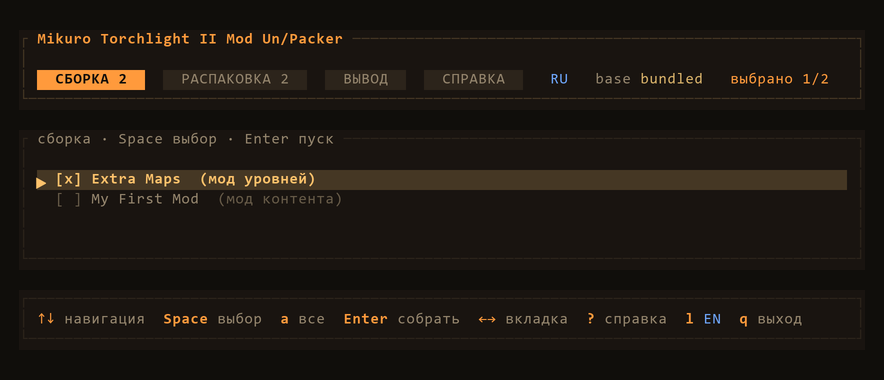
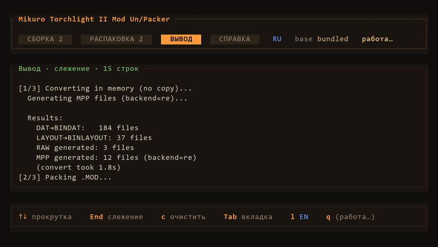
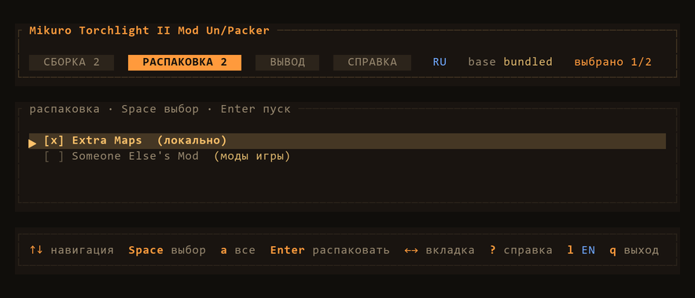

# tl2-mikuro-mod-packer-rs

*[English](README.md) · [中文](README.zh-CN.md)*

**Сборщик и распаковщик `.MOD`** для Torchlight 2 — один исполняемый файл, редактор
игры (GUTS) не нужен.

- **Сборка** — компилирует папку с исходниками мода (`MOD.DAT` + `MEDIA/`) в `.MOD`,
  который читает игра.
- **Распаковка** — превращает `.MOD` (или `DATA.PAK` базовой игры) обратно в
  **редактируемое дерево текстовых исходников**.

Все три двоичных формата (BINDAT / BINLAYOUT / MPP) — компиляторы, написанные с нуля:
разбор текста → сериализация в двоичный вид, без чтения готовых двоичных файлов, поэтому
правка текста всегда компилируется корректно. Два декомпилятора устроены так же, только
в обратную сторону. Для сборки **мода контента** не нужно ничего, кроме самого мода;
**моду уровней** нужны ещё и данные базовой игры, и exe спрашивает, где они, а не
угадывает.

Эталонная реализация на Python `mikuro_mod_packer` заархивирована на GitHub
(`heiybb/TL2-RE`); этот репозиторий — единственная используемая реализация.

> **Хотите разобраться по-настоящему?** Как собран контейнер, что представляет собой
> каждый из пяти двоичных форматов, какой именно хеш проверяет игра, как выпекается
> сетка проходимости — и настоящий механизм классических сбоев (мод отмечен в лаунчере,
> но ничего не происходит / портрет превратился в другую картинку / после перехода между
> уровнями персонаж не двигается):
> **[What's Actually Inside a .MOD](https://tl2-mod.chr.moe/en/devlog/tl2-mod-packing-full-analysis/)**
> на Emberworks (по-английски). Этот README — руководство, та статья — объяснение.

---

## Насколько быстро — против собственного редактора игры

Собрать всю серию 挑战者大陆 — десять компонентов, 173 тысячи файлов — официальному
редактору GUTS требуется **983 секунды**, этому сборщику — **46**. По компонентам
ускорение от 2× до 43×, и наибольший разрыв там, где редактор выпекает сетки
проходимости.

Нативные числа взяты из бенчмарка в заархивированном `heiybb/TL2-RE` (форк headless
`tl2_console_fork`, управляющий настоящей EditorGuts.dll; разовые 3.85 с InitEditor
амортизированы, тёплый замер по `CreateMod` + `EditorRegenPathingData`). Эти 5 прогонов на
Rust выполнялись на **тех же копиях исходников, что и нативный бенчмарк**
(`E:\Torchlight 2\mods`, где рядом лежат скомпилированные файлы — отсюда большее число файлов).

| Компонент | Файлов | native build | native MPP | native итого | Rust ×5 (с) | Rust среднее | Ускорение |
| --- | --: | --: | --: | --: | --- | --: | --: |
| 通用素材01 | 12712 | 164.05 | 208.77 | 372.82 | 6.46/11.75/12.37/6.25/6.05 | **8.58** | **43.5×** |
| 职业技能 | 68217 | 268.42 | 0.00 | 268.42 | 12.14/19.55/8.85/9.30/11.05 | **12.18** | **22.0×** |
| 群魔堕落 | 52438 | 169.36 | 0.51 | 169.87 | 12.79/7.56/7.66/8.09/16.58 | **10.54** | **16.1×** |
| 暗黑传奇 | 32020 | 97.86 | 6.02 | 103.88 | 9.46/5.21/5.36/9.76/10.18 | **7.99** | **13.0×** |
| 暗黑世界(临时) | 354 | 9.68 | 17.26 | 26.94 | 0.89/0.76/2.10/2.30/1.73 | **1.56** | **17.3×** |
| 佣兵系统 | 2956 | 14.16 | 0.86 | 15.02 | 1.09/0.79/1.02/2.48/2.47 | **1.57** | **9.6×** |
| 至尊适配 | 1818 | 11.14 | 0.00 | 11.14 | 0.82/0.56/0.57/1.23/1.31 | **0.90** | **12.4×** |
| 实验内容 | 470 | 8.31 | 0.00 | 8.31 | 0.65/0.47/0.47/1.07/1.06 | **0.74** | **11.2×** |
| 护身符 | 1348 | 4.29 | 0.00 | 4.29 | 0.48/0.36/0.96/0.99/0.33 | **0.62** | **6.9×** |
| 宠物系统 | 431 | 1.96 | 0.17 | 2.13 | 0.51/0.43/1.83/1.76/0.38 | **0.98** | **2.2×** |
| **Итого** | | 749.2 | 233.6 | **982.8** | | **45.66** | **21.5×** |

- Сумма лучших из 5 по каждому компоненту = 31.0 с → **31.7×**; разброс между прогонами
  даёт в основном сканирование Defender и сброс кеша записи (каждый круг пишет ~600 МБ `.MOD`).
- 地图拓展 (242.98 с) и POE (52.72 с) есть в нативной таблице, но копии их исходников удалены
  и перемерить нельзя, поэтому в итог они не входят.
- MPP сравнивается не один к одному: нативный = EditorRegenPathingData (побайтово); Rust =
  офлайн-бэкенд `re` (≈99.7% точности по ячейкам, известный потолок — фактическая
  проходимость уже на полу точности float, см. раздел
  [Можно ли выпускать моды с выпеченными сетками?](#walkgrid)).

---

## Быстрый старт

```powershell
cargo build --release
# получится target\release\tl2-mikuro-mod-packer.exe — один файл, копируйте куда угодно
```

Три способа запуска — выбирайте по задаче:

| Что нужно | Как |
| --- | --- |
| Пощёлкать мышкой | **Двойной клик по exe** (или положить его в папку мода / игры и запустить) → интерактивный интерфейс |
| Скрипты, CI | Запуск с аргументами → обычная утилита командной строки |
| Один файл за раз | Подкоманды `compile-dat` / `decompile-layout` / … |

---

## Наглядное руководство по интерфейсу

Без аргументов программа открывается на списке выбора. Ниже — **настоящие кадры**,
которые рисует программа, на русском; в [английском](README.md) и
[китайском](README.zh-CN.md) README тот же обход на своём языке. Обратите внимание,
что *не* переводится: названия модов, пути и все флаги CLI — это то, что вы набираете.

### 1 · Выберите, что собрать



Сюда попадает каждая папка с `MOD.DAT` — из папки самого exe, из её подпапки `mods\`
и сама эта папка, если вы положили exe внутрь мода. `↑↓` — перемещение, `Space` —
отметить, `a` — отметить всё, `Enter` — запуск. Если не отмечено ничего, `Enter`
собирает строку под курсором.

Оба списка сканируются при запуске программы. `r` сканирует заново, так что папка
мода, которую вы только что добавили, или `.MOD`, который вы только что собрали или
удалили, появляется без перезапуска. Отметки и курсор остаются на месте.

Каждая строка помечена как `мод уровней` или `мод контента`. Решает одна проверка —
есть ли в `MEDIA/LAYOUTS` хоть один `*.LAYOUT`? — и от неё зависит, будут ли
выпекаться сетки проходимости, самая долгая часть сборки.

### 2 · Наблюдайте за ходом



Интерфейс переключается на ВЫВОД и построчно транслирует собственный лог сборщика,
так что долгая сборка никогда не выглядит зависшей. `↑↓` — прокрутка (слежение при
этом отключается), `End` — снова следить за концом, `c` — очистить, `q` — выход, но
не во время работы: иначе дочерний процесс остался бы сиротой.

### 3 · В обратную сторону: распаковка



Найденные `.MOD` — рядом с exe, в `.\mods` и, что важнее всего, **в папке модов самой
игры**; каждая строка помечена `локально` или `моды игры`, чтобы свежую сборку было
видно отдельно от установленного. Результат попадает в `unpacked\<имя>\` рядом с exe.
**Распаковка никогда не пишет в папку модов игры**, поэтому разбирать установленный
мод безопасно.

---

## Сборка

### Что считается исходником мода

Папка с **`MOD.DAT`** и деревом **`MEDIA/`**. `MOD_FILE_NAME` из `MOD.DAT` задаёт имя
выходного файла (запасной вариант — имя папки), а `NAME` / `DISPLAYNAME` — заголовок,
который показывает игра.

### Команда

```powershell
tl2-mikuro-mod-packer.exe [--in-place|--temp-copy] [--mpp {re,none}] [--raw {auto,none}] [--deploy] <папка_мода>
```

Происходит четыре вещи по порядку (`convert_all`):

1. `*.DAT` → BINDAT
2. `*.LAYOUT` → BINLAYOUT
3. Генерируются индексы `MEDIA/*.RAW` (AFFIXES / SKILLS / TRIGGERABLES / MISSILES / UI / UNITDATA / ROOMPIECES)
4. Выпекаются сетки проходимости `.MPP` (только для модов уровней)

Затем пишется контейнер: заголовок + секция данных + манифест, плюс два хеша, которые
проверяет игра (rollingHash и mhash манифеста).

### Куда попадают скомпилированные файлы — выберите одно

Это единственный вопрос, на который отвечают `--in-place` / `--temp-copy`:

| Флаг | Поведение |
| --- | --- |
| нет (по умолчанию) | Компиляция в памяти — **на диск пишется только `.MOD`** |
| `--in-place` | **ТАКЖЕ** оставить `.BINDAT` / `.BINLAYOUT` в вашем дереве `MEDIA/` |
| `--temp-copy` | Компилировать на диске во временной копии; ваша папка остаётся чистой |

### Куда попадает `.MOD`

| Флаг | Результат |
| --- | --- |
| нет | `<папка_мода>\<MOD_FILE_NAME>_<временная_метка>.MOD` |
| `--deploy` | `%USERPROFILE%\Documents\My Games\Runic Games\Torchlight 2\mods\<MOD_FILE_NAME>.MOD` |

`--deploy` определяет этот путь через Shell Folders в реестре, поэтому папка Documents,
перенаправленная в OneDrive, обрабатывается правильно.

### Остальные переключатели

- `--mpp re` (по умолчанию) выпекает сетки проходимости; `--mpp none` оставляет те
  `.mpp`, что уже есть в исходниках. Моду контента (нет `*.LAYOUT` в `MEDIA/LAYOUTS`)
  выпекать нечего, так что `none` там просто быстрее.
- `--raw auto` (по умолчанию) генерирует RAW-индексы по мере надобности, по типам
  содержимого; `--raw none` пропускает их полностью.

<a id="walkgrid"></a>

### Можно ли выпускать моды с выпеченными сетками?

Да. Об этом стоит сказать прямо, потому что цифры точности ниже вне контекста
выглядят пугающе.

`--mpp re` выпекает сетки офлайн, не запуская редактор, и даёт ~99.7% ячеек,
побайтово совпадающих с нативной выпечкой. Это число учитывает **косметические**
различия: ячейка — это `0` проходимо, `1` стена, `255` пустота, а поиск пути
относится к 1 и 255 одинаково — обе непроходимы. Если считать только то, что
чувствует игрок (1 ≡ 255), совпадение — **99.89%**, и худшая измеренная плитка
лежит **на уровне шума, а не выше него**: наша выпечка расходится с нативной на
**0.106%** ячеек, тогда как две *нативные* выпечки той же плитки расходятся между
собой на **0.097%** — тот же порядок величины. Нативный пекарь недетерминирован —
box его региона скачет между 1100 и 1125 ячейками от прогона к прогону, — так что
«побайтово» никогда и не было достижимой целью, а честная мерка — native против
native. Именно поэтому офлайн-бэкенд оставлен единственным.

### Данные базовой игры (зачем они сборке)

Две вещи невозможно вычислить по одному лишь моду:

- `UNITDATA.RAW` идёт по цепочке `BASEFILE` каждого юнита в шаблоны `UNITS`
  **базовой игры**, чтобы прочитать `UNITTYPE` / `LEVEL` / `RARITY` / `CREATEAS`.
- Сетки `.MPP` выпекаются по **геометрии столкновений** базовой игры.

Поэтому сборщику нужны базовые данные, и он берёт первый доступный:

1. распакованная `MEDIA/` рядом с exe (настоящая распакованная установка)
2. `PAKS/DATA.PAK` — или `DATA.PAK` — рядом с ним (извлекается при первом использовании)
3. `TL2_MEDIA_DIR`, если вы её задали
4. дерево, выбранное в прошлый раз — запомнено в `.tl2packer_base_dir`

**Если не ответил ни один — спросим.** Сборщик не ищет установку сам и не имеет
молчаливого последнего уровня. И то и другое было раньше, и было неверно по одной
причине: на машине может быть несколько подходящих деревьев — например установка
Steam и отдельно распакованное дерево для сравнения — и выбор не того незаметен.
Layout Link в базовую игру не разрешаются, геометрия за ними не попадает в сетку,
сборка всё равно проходит, а единственный симптом — земля, которую игрок видит и по
которой не может идти.

Когда спрашивает, можно разрешить поиск — найденное показывается списком на выбор, а
не применяется само — или вставить путь: папку `MEDIA`, папку игры или `DATA.PAK`.
Путь без данных игры отклоняется сразу. Ответ запоминается, проверяется при каждом
запуске, меняется по `b`.

Уровень 2 один раз распаковывается в кеш `.tl2packer_base\` рядом с exe (~2,6 с,
102 МБ) и дальше переиспользуется. Решает метка `.version` внутри: измените её — и все
существующие кеши пересобираются; именно это не даёт переиспользовать кеш, в котором
должно появиться новое. Метка пишется последней, поэтому прерванный запуск оставляет
кеш без метки, который в следующий раз пересоберут, а не примут на веру.

Уровни 1-3 дают побайтово одинаковый `.MOD` — проверено на моде из 173 layout'ов,
173/173 сетки совпадают.

Сборка также сообщает о Layout Link, чью цель не удалось найти:

```
WARNING: 12 Layout Link(s) across 4 target(s) did not resolve — their geometry is
         MISSING from the baked grids
           6 x MEDIA/LEVELSETS/PROPS/EXIT_CHALLENGE.LAYOUT
```

Единицы — висячие ссылки в моде. Тысячи — не то базовое дерево или в нём нет `.LAYOUT`.

---

## Распаковка

### Почему нельзя просто распаковать архив

`.MOD` — **не** обычный архив. Компиляторы отработали до его записи, и контейнер хранит
**скомпилированные данные под именами исходников**: в `FOO.DAT` на самом деле лежит
BINDAT, в `FOO.LAYOUT` — BINLAYOUT. Поэтому распаковка обязана **декомпилировать**, иначе
полученное дерево будет состоять из файлов, которые выглядят как исходники, а являются
двоичными.

```text
.MOD ─┬─ заголовок   → MOD.DAT              (обратное к build_header)
      ├─ *.DAT       → bindat_decompile     → текстовый .DAT в UTF-16LE
      ├─ *.LAYOUT    → binlayout_decompile  → текстовый .LAYOUT в UTF-16LE
      └─ всё прочее                         → пишется как есть
```

### Команда

```powershell
tl2-mikuro-mod-packer.exe unpack <in.MOD|DATA.PAK> <папка_вывода> [--raw] [--no-times] [--filter <текст>]
```

- `--raw` — не декомпилировать, писать содержимое как есть (`.DAT` останется BINDAT).
  Пригодится, когда нужно увидеть, что хранится на самом деле.
- `--no-times` — не восстанавливать временные метки файлов из манифеста.
- `--filter <текст>` — только записи, в пути которых встречается этот текст (без учёта
  регистра), например `--filter SKILLS`.

То, что получается, **и есть папка исходников мода**: правьте и собирайте обратно.
`PAKS\DATA.PAK` базовой игры (вместе с файлом-спутником `DATA.PAK.MAN`) распаковывается
так же, только заголовка мода у него нет, поэтому `MOD.DAT` не пишется.

### Что распаковка вам сообщает

В конце она печатает строки `note:`. Это не ошибки, но прочитать их стоит:

| Сообщение | Что значит / что делать |
| --- | --- |
| `gameVersion 0x… is not stored in MOD.DAT` | При сборке значение читается из установленного `Torchlight2.exe`; в MOD.DAT такого поля нет. Чтобы воспроизвести оригинал, задайте `TL2_MOD_GAMEVER=0x…` перед пересборкой |
| Заглушки `UNK_<HEX8>` | Имя ключа DAT, которое словарь не смог восстановить. Оно **компилируется обратно в тот же хеш** (игра читает нормально), но читаемое имя потеряно. ⚠️ Никогда не правьте цифры в `UNK_` вручную — это и есть хеш |
| `container lists N duplicate paths` | Контейнер перечислил один путь несколько раз (частое дело у сторонних модов). Побеждает последняя запись — тот же результат, что давала последовательная распаковка |
| `BINLAYOUT flag byte is 0x36, not the usual 0x04` | Собрано каким-то другим инструментом. Пересборка запишет `0x04` |
| `will not decompile …; kept as FOO.LAYOUT.BINLAYOUT` | Декомпиляция не удалась; данные сохранены как есть под скомпилированным именем. Пересборка не включит эту запись, пока не появится текстовый исходник |

### Круговой цикл (распаковка → пересборка)

| Проверка | Результат |
| --- | --- |
| Юнит-тест `pack_unpack_repack_is_byte_identical` | сборка → распаковка → пересборка даёт **идентичный SHA256** |
| Настоящий сторонний мод из GUTS (熊猫联纵三号, 3452 файла) | 3452/3453 побайтово совпадают; единственное отличие — **порядок записей** в сгенерированном `UNITDATA.RAW` |
| 绿洲联盟 9 号 (73 файла) | 73/74 совпадают, причина та же (порядок в `UI.RAW`) |

Три вещи, которые ПЕРВЫЙ круг восстановить не может (это свойство механизма, а не потеря
данных): **gameVersion** (см. таблицу выше), **имена ключей вне словаря** (выдаются как
`UNK_`) и **порядок сгенерированных `MEDIA/*.RAW` в манифесте** — у них нет файла-исходника,
поэтому сборщик дописывает их после обхода диска; как только распаковка положит их на диск,
следующий обход подхватит их в отсортированной позиции. Набор записей, содержимое и оба
проверочных хеша при этом не меняются, и **начиная со второго круга распаковка ↔ сборка
полностью побайтово стабильны**.

Ещё: `packer::filetime_of` работает через секунды в `f64` (53-битная мантисса не вмещает
57-битные тики FILETIME), поэтому восстановленная метка времени может отличаться на ±2 тика
(200 нс). Поле носит исключительно информационный характер.

### Две границы безопасности, которые не сдвигаются

1. Пути из манифеста проходят через `sanitize_rel`: `..`, буквы дисков и обратные слеши
   отвергаются, поэтому **запись за пределы целевой папки невозможна**.
2. **Данные, которые не декомпилируются, никогда не пишутся под именем исходника.** Они
   откладываются как `FOO.LAYOUT.BINLAYOUT` с предупреждением — потому что `content_for`
   иначе «скомпилировал» бы то, что лежит под именем исходника, а компиляция двоичного
   блоба как текста layout даёт **пустой layout в 8 байт**. Вот это и было бы настоящим
   тихим уничтожением данных.

---

## Интерактивный интерфейс (без аргументов)

Двойной клик по exe — или положить его в папку мода / игры и запустить — открывает
интерфейс на ratatui с четырьмя вкладками:

| Вкладка | Содержимое |
| --- | --- |
| **СБОРКА** | Найденные исходники модов, каждый помечен как мод контента / мод уровней |
| **РАСПАКОВКА** | Найденные файлы `.MOD`, каждый помечен как локально / моды игры |
| **ВЫВОД** | Лог выполнения в реальном времени; `c` очищает |
| **СПРАВКА** | Написана из **настоящих путей кода**: три уровня базовых данных и какой из них активен, реальные пути поиска и вывода, все команды CLI |

Где ищет:

- СБОРКА — папка самого exe и её подпапка `mods\` (**сама эта папка тоже считается**,
  если в ней есть `MOD.DAT`)
- РАСПАКОВКА — те же две, **плюс папка модов игры** (куда пишет `--deploy`, так что
  только что собранное сразу видно)

Оба списка сканируются при запуске и снова по нажатию `r` — именно так подхватывается
папка мода, добавленная при открытом интерфейсе, или только что собранный `.MOD`.

Куда пишет: СБОРКА всегда разворачивает результат в папку модов игры. РАСПАКОВКА пишет в
`unpacked\<имя>\` рядом с exe и **никогда не трогает папку модов игры**, поэтому разбирать
установленное безопасно.

Клавиши: `↑↓` перемещение · `Space` отметить · `a` всё · `Enter` запуск ·
`r` пересканировать · `Tab` / `1`-`4` вкладки · `?` справка · `l` язык ·
`c` очистить лог (ВЫВОД) · `q` или `Ctrl+C` выход.

Язык интерфейса выбирается по языку системы (английский / китайский / русский);
`TL2_LANG=en|zh|ru` переопределяет его, а `l` переключает на лету. Чтобы поправить
формулировки или добавить язык без пересборки, положите отредактированный ini рядом с exe
как `lang\<код>.ini`: его ключи побеждают встроенные, а всё, что вы не указали, берётся из
встроенных.

---

## Однофайловые инструменты и верификатор

```powershell
tl2-mikuro-mod-packer.exe compile-dat      <in.DAT>       <out.BINDAT>  [--global-dict <dict.bin>]
tl2-mikuro-mod-packer.exe compile-layout   <in.LAYOUT>    <out.BINLAYOUT>
tl2-mikuro-mod-packer.exe compile-mpp      <in.LAYOUT>    <out.mpp> [--media <MEDIA>] [--fallback <base MEDIA>]
tl2-mikuro-mod-packer.exe decompile-dat    <in.BINDAT>    <out.DAT>  [--utf8]
tl2-mikuro-mod-packer.exe decompile-layout <in.BINLAYOUT> <out.LAYOUT>
tl2-mikuro-mod-packer.exe extract-base     <DATA.PAK>     <папка>     # базовые LEVELSETS DAT + меши столкновений + layout'ы ссылок

verify.exe binlayout|binlayout-roundtrip|bindat|raw|mpp|mpp-corpus <media_dir> ...
verify.exe unpack <mod.MOD>     # распаковка → пересборка → сверка содержимого каждой записи
```

`compile-mpp --fallback <base MEDIA>` включает **VFS-наложение mod-over-base** для одной
плитки (сначала ищем в моде из `--media`, затем в базовой установке из `--fallback`), чтобы
отдельная плитка разрешала link/mesh базовой игры так же, как это делает полная сборка.
Полная сборка (основная команда) применяет это наложение сама.

`decompile-dat` по умолчанию пишет **пригодный к правке** `.DAT` в UTF-16LE; `--utf8` даёт
обычный текстовый дамп для чтения.

## Переменные окружения

| Переменная | Действие |
| --- | --- |
| `TL2_MEDIA_DIR` | Путь к MEDIA базовой игры. **Значения по умолчанию нет** — если не задано, TUI спросит, а CLI откажется выпекать проходимость вместо угадывания (`--mpp none` собирает без неё) |
| `TL2_MOD_GAMEVER` | Переопределяет gameVersion в заголовке (нужно при круговом цикле распаковки) |
| `TL2_LANG` | Язык интерфейса: `en` / `zh` / `ru` |
| `MIKURO_TIMING` | Печатать пофазный тайминг |
| `MIKURO_BINDAT_DICT` | Использовать корпусный режим строковых id в BINDAT (см. последний раздел) |
| `TL2_MODPACK_LIST` | Пропустить интерфейс и вывести найденное в stdout (диагностика / CI) |

---

## Состояние проверки (2026-07-04)

| Модуль | Как | Результат |
| --- | --- | --- |
| BINLAYOUT | Все 8985 `.LAYOUT` базовой игры, байты против shipped | **8965/8985 побайтово** (20 промахов — невоспроизводимый неинициализированный мусор `@25` в самих shipped-файлах) |
| BINDAT | 400 случайных образцов + TAGS.DAT против эталонной реализации | **401/401 идентично** (включая TAGS.DAT с недопустимым суррогатом UTF-16) |
| RAW ×7 | против shipped `MEDIA/*.RAW` базовой игры | **7/7 побайтово** (AFFIXES/SKILLS/TRIGGERABLES/MISSILES/UI/UNITDATA/ROOMPIECES) |
| MPP (офлайн `re`) | 13 разных плиток (обрыв / алиас ориентира / босс / город / выход / пещера / хранилище) против эталонной реализации | **13/13 идентично** |
| Целый `.MOD` | Три настоящих мода, контейнер против контейнера | заголовок и манифест структурно идентичны; **все 1856 / 35864 / 11205 файлов совпадают по распакованному содержимому, CRC и ftime**; rollingHash и mhash самосогласованы (два хеша, которые проверяет игра) |
| Неподвижная точка декомпиляции BINLAYOUT | наш BINLAYOUT → декомпиляция → перекомпиляция | **8986/8986 побайтово** |
| то же, но с shipped-двоичных | shipped BINLAYOUT → декомпиляция → компиляция | **8967/8986** — 19 неудач это **ровно те**, которые не воспроизводит сама компиляция; декомпилятор не добавляет ни одной |

Единственное байтовое отличие нашего контейнера от контейнера любого другого сборщика —
поток zlib, то есть другой бэкенд сжатия. Игра только распаковывает и разницы не видит,
а наш вывод чуть меньше.

`src/binlayout_decompile.rs` достигает неподвижной точки потому, что BINLAYOUT несёт свою
структуру целиком: **та же вшитая схема** (`data/binlayout_schema.json`) в обратную сторону
именует всё — в отличие от BINDAT, которому нужен словарь. Отброшенное компилятором
восстанавливается по критерию «перекомпилируется побайтово»: `PARENTID` выводится из дерева
объектов; `CHOICE` / `GAME MODE` / `TAG` / `RANDOMIZATION` / `NUMBER` / `NO TAG FOUND` /
`LEVEL UNIQUE` / `ACTIVE|DEACTIVE THEMES` группы существуют только в хвостовой datagroup и
структурно возвращаются на объекты Group; значения по умолчанию (RANDOMIZATION 1, NUMBER 1,
без TAG) выдаются только тогда, когда они не по умолчанию. Ориентации по умолчанию
(`FORWARD` Z==1 / `RIGHT` X==1 / `UP` Y==1, пропускаемые при компиляции) **намеренно не
восстанавливаются**: в shipped-исходниках `.LAYOUT` их тоже нет, а придумать такую строку —
значит **утверждать** ориентацию для любого читателя ниже по течению; тот, кто выводит `UP`
как `FORWARD × RIGHT`, принял бы фальшивку за истину.

## Пропускная способность — вся серия 挑战者大陆, 10 компонентов (2026-07-04, 16 ядер, прогретый кеш, вывод сверен пофайлово)

После оптимизации (параллельное чтение содержимого в Pass A + бэкенд libdeflate + конкурентный RAW без блокировок):

| Компонент | Время | Размер .MOD |
| --- | --: | --: |
| 宠物系统 | **0.32s** | 0.41 MB |
| 护身符 | **0.30s** | 0.73 MB |
| 暗黑世界(临时) | **0.64s** | 1.38 MB |
| 至尊适配 | **0.46s** | 25.8 MB |
| 实验内容 | **0.40s** | 18.0 MB |
| 佣兵系统 | **0.64s** | 19.7 MB |
| 暗黑传奇 | **3.93s** | 43.7 MB |
| 群魔堕落 | **5.89s** | 76.5 MB |
| 职业技能 | **5.98s** | 106.6 MB |
| 通用素材01 | **5.16s** | 263.5 MB |
| **Итого** | **23.7s** | 556 MB |

Все эти сборки не просто засекались по времени: у каждой записи сверялись распакованное
содержимое, CRC и ftime, а rollingHash и mhash оставались самосогласованными. RAW 7/7 и
BINLAYOUT 8965/8985 против shipped-корпуса перепроверены после оптимизации и по-прежнему
побайтовы.

`MIKURO_TIMING=1` печатает пофазный тайминг, по которому шла настройка. Осталась стоимость
открытия файла в Windows (десятки тысяч мелких чтений AFFIXES/SKILLS, уже размазанные по
потокам; главный источник — сканирование Defender в реальном времени) и классификатор MPP
(~1.9 с на 170 плиток). Выжимать дальше почти нечего.

Со стороны распаковки: переход на параллельную обработку дал 1.02 → 0.23 мс на файл —
87764 файла за 19.7 с вместо 82.4 с (**4.2×**), причём вывод побайтово совпадает с
последовательной сборкой (содержимое + mtime, 73848 файлов).

### A/B по всему корпусу MPP (`verify mpp-corpus`, 2026-07-04)

Против корпуса-оракула из 1293 плиток (`TL2-RE/tools/mpp_corpus`):

```
compile+compare 1293 tiles: 10.3s   (context 0.1s)
byte-exact files: 118/1293   dim-match: 1272/1293
cells: 95,773,940   diff: 276,839   accuracy: 99.7109%
```

**Число расхождений совпадает с архивной цифрой эталонной реализации (276839 / 95.7M)
ячейка в ячейку** — пооперационный порт ядер на f64 эквивалентен на масштабе всего корпуса.
Эти числа по **ванильному корпусу** не затронуты исправлениями для модов ниже (в ванили нет
Layout-Link-в-базу и цепочек клонов; оба исправления не меняют ни байта на всех 1293 плитках).

### A/B по плиткам модов + исправления Layout-Link (2026-07-12)

Ванильные shipped-`.mpp` выпечены годы назад, да и сам нативный пекарь недетерминирован (см.
ниже), поэтому для плиток **модов** оракулом стала **свежая нативная выпечка**
(`TL2-Mikuro-Console --clean --twice`), сверка по ячейкам на 17 плитках ACT5 из
挑战者「通用素材01」. Так нашлись и были исправлены две **связки MPP+LAYOUT**:

1. **Разрешение Layout-Link с откатом в базовую установку** (`resolve_link_layout` получил
   `fallback_dir` — то же VFS-наложение mod-over-base, что и для мешей столкновений). Ссылка
   мода на компоновку пропа из базовой игры (например `CABIN_01_NOSPAWNER.LAYOUT`, который
   есть в установке, но не в моде) раньше не разрешалась → её столкновения не попадали в
   выпечку → целый след пропа недоблокировался (дыра в 2475 ячеек в DARKWOODS).
2. **Наследование трансформа: родитель Layout-Link НЕ передаёт свой трансформ вниз**
   (`compute_world` распространил существующий учёт клонов Room-Piece на `Layout Link*`).
   В DARKWOODS есть цепочки клонов Layout-Link-под-Layout-Link (локальный масштаб 2–3 на
   уровень, ×72); нативная выпечка с box 1100×1626 **требует** отсутствия наследования (при
   полном наследовании он раздувается до 1776×2050) — это установлено по нативному выводу, а
   не подобрано.

Результат на 17 плитках против свежей нативной выпечки: **99.7232% → 99.7718%** суммарно,
12 улучшений и 0 регрессий (DARKWOODS −3171, DARKWOODS111 −3167, NETHER −2426); ванильный
корпус не изменился ни на байт; вывод `compile-mpp` **побайтово** совпадает с эталонной
реализацией на этих 17 плитках плюс 8 ванильных.

**Нативный недетерминизм и есть настоящий потолок точности float (измерено).** Выпеките одну
и ту же плитку мода дважды: box региона DARKWOODS скачет между **1100 и 1125** (±25 ячеек =
одна snap-плитка в 10 юнитов; какая-то граница столкновения стоит ровно на пороге привязки, и
шум float то заводит её внутрь, то нет), а две выпечки одного и того же box всё равно
расходятся на ~0.1–0.6% ячеек (осцилляция обрывов). **⇒ Побайтовое совпадение с оракулом,
который сам недетерминирован, принципиально невозможно; правильная мерка пола — native против
native, а не побайтово-против-одной-выпечки.**

**Фактическая проходимость уже на полу точности float.** Семантика ячеек: `0 = проходимо`,
`1 = стена`, `0xFF = пустота`; для поиска пути 1 и 255 одинаково непроходимы. Пересчёт
«без косметики» (1 ≡ 255): суммарно **99.8934%**, THECROSSING **99.8938% ≈ его собственный
пол в 0.0965%**. Примерно половина оставшегося байтового расхождения — разметка 255↔1
пустота/стена внутри групп деревьев (на проходимость внутри плитки не влияет, значима только
на швах между плитками), остальное — неустранимый float. **Иначе говоря, реальная проходимость
сетки уже совпадает с нативной до пола точности float — по этой причине офлайн-бэкенд оставлен
единственным.**

Остаток по ванильному корпусу выше (276839 ячеек) относится к тому же
теоретико-информационному полу (нативный недетерминизм по обрывам/multichunk + runtime
nocollide на экземпляр); смена языка или точности его не двигает.

## Карта модулей

| Модуль | Назначение |
| --- | --- |
| `src/rghash.rs` | RGHash (== EditorGuts sub_100CA9A0), хеширование по кодовым точкам |
| `src/text.rs` | Слой, эквивалентный UTF-16 surrogatepass (`WStr = Vec<u32>`, строка кодовых точек) |
| `src/bindat.rs` | Пофайловые хеш-id строк (`HashStringDict`); семантика сортировки и пробирования выровнена по пунктам |
| `src/binlayout.rs` | Чистая схема из DLL, вшитая через `include_str!` (`data/*.json`) |
| `src/raw.rs` | Оба порядка обхода (files-first / interleaved) + цепочка наследования BASEFILE в UNITDATA |
| `src/packer.rs` | Запись контейнера, rollingHash/mhash, дерево манифеста, оркестрация convert_all |
| `src/binlayout_decompile.rs` | BINLAYOUT → LAYOUT (обратный поиск по схеме; неподвижная точка 8986/8986) |
| `src/bindat_decompile.rs` | BINDAT → DAT (вшитый словарь + escape-форма `UNK_<HEX8>`) |
| `src/pak.rs` / `src/unpack.rs` | Чтение контейнера (заголовок/манифест/блоки) и `.MOD` → дерево исходников |
| `src/tui.rs` | Интерфейс на ratatui |
| `src/mpp/*` | Округление f32 в заголовке региона выровнено пооперационно; рабочий построитель сетки отсеивает по корзинам и распараллелен построчно через rayon |

Поведение, намеренно сохранённое «баг в баг»: ogre_mesh читает только первый элемент
объявления вершин (унаследованный баг шага +14; POSITION всегда элемент 0); binlayout проглатывает
первое вхождение `NAME` / `CHOICE` / `GAME MODE` как метаданные объекта; хеш пустого корневого
имени в TAGS.DAT. Подробности — в комментариях соответствующих файлов.

## Два режима id в BINDAT (с 2026-07-04)

После пофункционального аудита EditorGuts реализовано и **точное** поведение `sub_10289A40`
(раньше существовал только режим пофайловых хеш-id):

- **режим hash (по умолчанию)** — id строки = пофайловый RGHash + линейное пробирование.
  Никакой зависимости от корпуса, естественная параллельность, и проверено против того, как
  игра разбирает внутрифайловую таблицу. Продакшен-сборка идёт этим путём.
- **режим corpus** — id строки берётся из восстановленного словаря глобального интернера GUTS
  (`data/bindat_string_dict.bin`, 154627 строк, разовая загрузка 0.05 с); неизвестные строки
  получают `max_id+1, +2, …` **в порядке первого появления**, как в `sub_1023E9F0` с его
  `id = counter++`. Вывод **побайтово совпадает с shipped базовой игрой в 15976/16084 случаях**
  (108 отличий — известные float-причуды shipped + TAGS.DAT,
  а не проблемы реализации). Включается через `MIKURO_BINDAT_DICT=<dict.bin>` при
  сборке или `compile-dat <in> <out> --global-dict <dict.bin>` для одного файла; проверка —
  `verify bindat-corpus <media_dir> <dict.bin>`.

**Производительность**: режим corpus даже немного *быстрее* (весь корпус, 16084 файла: ~1.0 с
против ~1.2–1.7 с; 22027 DAT из 职业技能 сквозным счётом 1.59 с против 1.75 с) — режим hash
платит за отсортированный BTreeSet и пробирование на каждый файл, тогда как corpus — это
чтение по таблице, разделяемой между воркерами rayon без блокировок. **Регрессии
производительности нет.**

**Почему по умолчанию всё же hash**: корпусный словарь несёт 715 коллизий id, разрешённых
голосованием большинства по shipped-корпусу (две разные строки делят один id; если обе
встречаются в одном файле, поздняя перезаписывает раннюю). Режим hash гарантирует уникальность
id внутри файла и потому безопаснее как продакшен-умолчание; corpus нужен для побайтового
сравнения и аудита против вывода GUTS.
